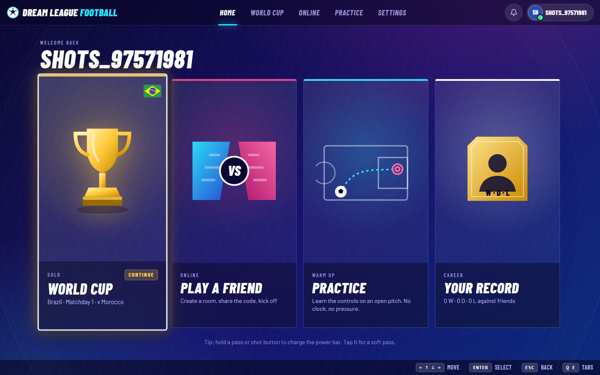
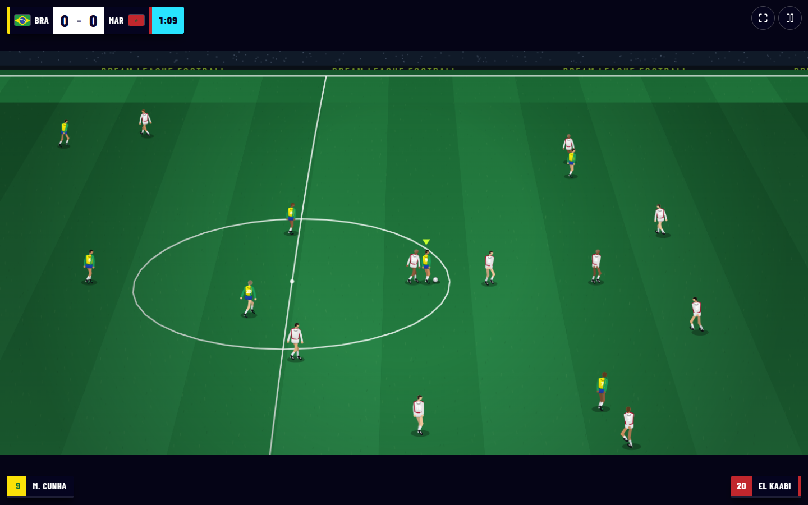
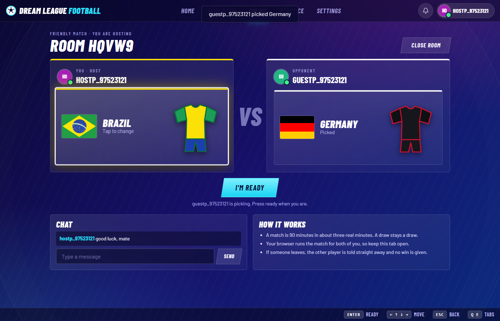
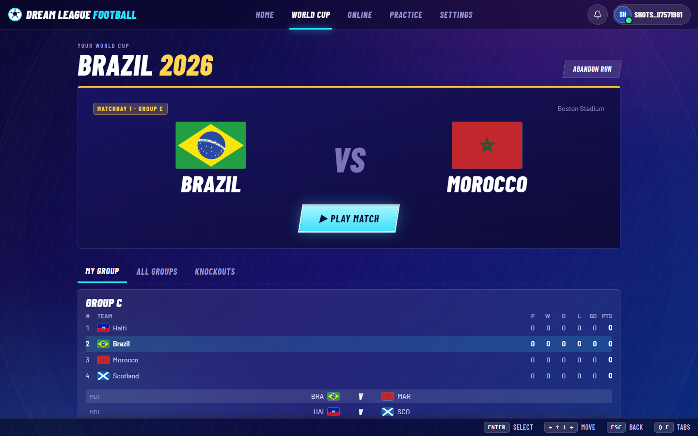
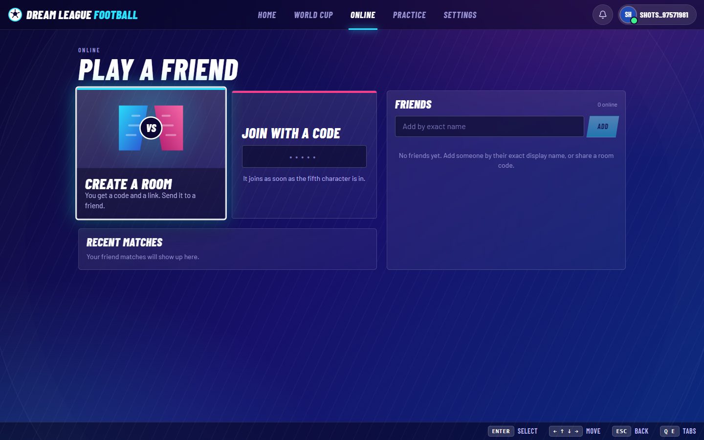
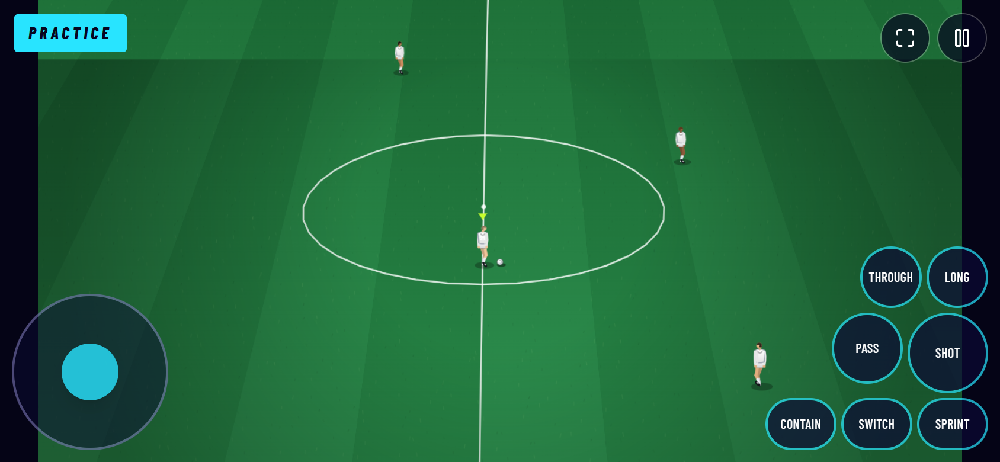
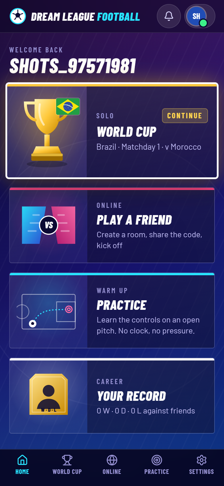

# Dream League Football

An arcade, FIFA-style football game that runs in your browser, with a **[Serverpod](https://serverpod.dev) backend** for accounts, a persistent solo World Cup, live online matches, a **server-refereed penalty duel**, matchmaking and ratings.

Play it: <https://football.serverpod.space> (web) · API: <https://football.api.serverpod.space>



| | |
| --- | --- |
|  |  |
|  |  |

On a phone the same game runs in landscape with on-screen controls:

 

## Powered by Serverpod

The whole back end is a single Serverpod 4.0.3 project (Dart + PostgreSQL) in [`football/`](football/). It is the reason the game can remember anything, and it does more than store rows:

| Serverpod feature | What Dream League Football uses it for |
| --- | --- |
| **Authentication** (`serverpod_auth_idp`, email identity provider) | Sign-up with an emailed verification code, sign-in, password reset. Codes are printed to the console in development and emailed through **Serverpod Cloud's email service** in production, branded "Dream League Football". |
| **JWT token manager** | Short-lived access tokens (10 minutes) plus refresh tokens; the React app refreshes on expiry. |
| **Endpoints** (`Endpoint` classes, `requireLogin`) | 16 endpoint classes: profile, solo tournament, friend rooms, match results, friends, chat, reports, **matchmaking**, the **penalty duel**, **daily challenges**, **sharing**, operator tools. Called from TypeScript as plain `POST /<endpoint>/<method>` JSON, so the web app does not need the generated Dart client. |
| **ORM + models** (`.spy.yaml`) | 15 tables (profiles with a rating, tournaments, fixtures, lobbies, friend matches, penalty kicks, the matchmaking queue, shared results, friendships, blocks, invites, chat, reports, audit log). Typed, generated, with transactions and **row locks** (`LockMode.forUpdate`) so two players signing a result, choosing a penalty or being paired at the same instant never overwrite each other. |
| **Server as referee** | The **penalty duel** runs on the server: both players choose a zone in secret, the server draws the result with secure randomness, so there is nothing in a browser to cheat. **Matchmaking** pairs players by rating (a window that widens while they wait) and **Elo ratings** are updated in the transaction that finishes a match, with an anti-farming cap. |
| **Future calls** | A recurring **nightly maintenance job** (cron `0 3 * * *`: closes idle rooms, voids stuck matches, prunes the queue and old chat) and a **timeout call for every penalty kick**, so a duel finishes even if both players close their tabs. Stored in the database, so they survive restarts. |
| **WebSockets and web routes** | `/live` pushes "this changed" events (friends, rooms, chat, duels, the queue) to the right players, replacing most polling; `/relay/:matchId` carries a match when browsers cannot connect directly; `/r/:id` serves shareable result pages with Open Graph previews. All authenticated with the same JWT. |
| **Cloud storage** | Result pictures are stored in Serverpod Cloud public storage and shared as links that show the score as a preview in chat apps. |
| **Migrations** | 10 versioned migrations applied at boot (`--apply-migrations`). |
| **Embedded PostgreSQL** | Local development and tests need no Docker: `database.dataPath` makes Serverpod run its own Postgres. |
| **Web server (Relic)** | Serves the built React app with a single-page fallback and hosts the routes above. One origin in production: no CORS, no cookies. |
| **Serverpod Cloud** (`scloud`) | One-command deploy of the server, the database, the web app and the email service. Secrets (such as the operator list) are set with `scloud password set`. |
| **Testing** (`serverpod_test`, `dart test`) | 31 tests: unit tests for tie-breaks, the 2026 knockout bracket (all 495 third-place combinations), the two-signature result protocol, shootout rules, Elo and the daily challenge, plus **integration tests** that call the real endpoints (matchmaking and a whole duel) against a database. |

Read [docs/SERVERPOD.md](docs/SERVERPOD.md) for the full tour, and [docs/API.md](docs/API.md) for every endpoint.

## What you can do

- **Solo World Cup.** Pick one of the **48 nations** of the 2026 World Cup and play the real group draw, matchday by matchday. The server simulates the other games, builds the group tables (with head-to-head tie-breaks), draws the official Round-of-32 bracket (including the third-placed-team slots), and takes you through knockouts with extra time and a penalty shootout you take yourself. Every result is saved to your account.
- **Play online.** Pick a game: an 11 v 11 **match** or a **penalty duel**. Press **Find a match** to be paired with a player of a similar rating, or create a room and share the 5-character code, a link, the share sheet or a QR code (or invite a friend from your list). Both players see joins, leaves, nation picks and "ready" live (pushed by the server), then a 3-2-1 count-in starts the game. A match is simulated in one browser and streamed to the other over WebRTC (with the Serverpod relay as fallback), and both players sign the final score. A duel is refereed by the server. Your **rating** moves after each finished game; leaving tells your opponent immediately.
- **Penalty duel.** Five penalties each, then sudden death. Every kick both players pick one of six zones in secret, shooter and keeper, and Serverpod draws the result.
- **Penalty shootout** against the CPU, a **daily challenge** with a streak, and a leaderboard by **rating** or points.
- **Practice** on an open pitch with no clock and no pressure (works signed out).
- **Friends, chat, invites, blocks and reports**, a record with head-to-head, presence dots, account deletion.
- **Real football rules.** Offside, throw-ins, corners, goal kicks, fouls with free kicks and a four-man wall, penalties, yellow and red cards, extra time, shootouts.
- **Depth.** Charged shots and passes, through balls, lofted passes, slide tackles, contain, a goalkeeper with dives and handling rules, FIFA-style player ratings (pace, shooting, passing, dribbling, defending, physicality) that change how every player actually plays, and three CPU difficulty levels.
- **Make it yours.** 24 pre-made avatars, a club crest and kit editor, your own formation, a match length of 3, 5 or 8 minutes, and settings that follow your account.
- **Learn, compete, share.** An interactive tutorial, a full 11 v 11 friendly against the CPU, 14 achievements, a global leaderboard, quick chat in online matches, shareable result links with a score-picture preview, and an installable app.
- **Broadcast touches.** Goal replays, commentary captions, a stadium crowd, and added time at 90 minutes.
- **Play on anything, FIFA-style.** Keyboard (the FIFA classic arrows layout, or the EA FC WASD layout), controller (the EA FC Xbox/PlayStation layout) or touch. Every input is rebindable. The menus are console-style (arrows or D-pad, Enter/A, Esc/B) and the footer shows the buttons for the device you used last.

## Quick start

Prerequisites: Node.js 20+, and for the online features the Dart SDK with the Serverpod CLI (`dart pub global activate serverpod_cli`). No Docker needed.

```bash
npm install
npm run dev                 # the web app on http://localhost:5173 (practice works with no server)
```

With the Serverpod server (accounts, World Cup, friends):

```bash
cd football/football_server
cp config/passwords.example.yaml config/passwords.yaml    # then fill in the development secrets
dart bin/main.dart --apply-migrations --role monolith     # API :8080, web + relay :8082
```

In development the sign-up code is printed in the server console. Full instructions, including how to run the tests, are in [docs/DEVELOPMENT.md](docs/DEVELOPMENT.md).

Deploy to Serverpod Cloud:

```bash
npm run build:web                                  # builds the app into football/football_server/web/spa
cd football/football_server
scloud deploy --yes --non-interactive
```

## Default controls

| Action | Keyboard | Action | Keyboard |
| --- | --- | --- | --- |
| Move | Arrow keys | Through pass | `W` |
| Sprint | `E` | Lofted through ball | `Q` + `W` |
| Shot / standing tackle | `D` | Switch player | `Q` |
| Short pass | `S` | Contain (hold) | `C` |
| Long pass / slide tackle | `A` | | |

Hold a shot or pass to charge power, release to kick. *Settings → Keyboard → Layout* switches to the EA FC WASD layout (`WASD` move, `L` pass, `K` lob, `O` through, `;` shoot, `P` sprint, `I` change player). On a controller: `A` pass, `B` shoot, `X` lob, `Y` through, `RT` sprint, `LT` jockey, `LB` change player. All keys, controller buttons and touch buttons can be changed in Settings. More in [docs/GAMEPLAY.md](docs/GAMEPLAY.md).

## Tech stack

- **Back end:** Serverpod 4.0.3, Dart 3.12, PostgreSQL, Serverpod Cloud
- **Front end:** React 19, React Router 6, TanStack Query, Tailwind CSS v4, TypeScript, Vite
- **Game:** a hand-written engine on HTML5 Canvas (`requestAnimationFrame`) with a pseudo-3D TV broadcast camera
- **Real time:** WebRTC data channels with a Serverpod WebSocket relay as fallback, and a Serverpod `/live` WebSocket for push updates
- **Tests:** Playwright (real Chrome) end-to-end scripts, HTTP smoke tests, `dart test` (unit and `serverpod_test` integration tests)

## Documentation

| Document | What it covers |
| --- | --- |
| [docs/SERVERPOD.md](docs/SERVERPOD.md) | How Serverpod is used: a feature-by-feature tour (auth, endpoints, ORM, locks, server-refereed duel, matchmaking, Elo, live socket, future calls, cloud storage, web routes, tests, Cloud deploy) |
| [docs/API.md](docs/API.md) | Every endpoint, its arguments and rules |
| [docs/ARCHITECTURE.md](docs/ARCHITECTURE.md) | The whole system, the repo layout, the client, the engine, data flow |
| [docs/MULTIPLAYER.md](docs/MULTIPLAYER.md) | Online design: the host/guest match, the server-refereed penalty duel, matchmaking, live updates, ratings |
| [docs/GAMEPLAY.md](docs/GAMEPLAY.md) | Modes, controls, rules, ratings, difficulty, the World Cup format |
| [docs/UI.md](docs/UI.md) and [UI_PLAN.md](UI_PLAN.md) | The "Matchday Night" design system, screens, navigation, mobile |
| [docs/DEVELOPMENT.md](docs/DEVELOPMENT.md) | Setup, scripts, all tests, deploying, troubleshooting |
| [docs/ROADMAP.md](docs/ROADMAP.md) | Football mechanics the game has and lacks, experience ideas, and the online latency-fairness design |
| [PLAN.md](PLAN.md) | The original plan, the review that fixed it, and build status |
| [CHANGELOG.md](CHANGELOG.md) | What changed, by date |
| [AGENTS.md](AGENTS.md), [football/AGENTS.md](football/AGENTS.md) | Detailed engineering notes for contributors and coding agents |

## Repository layout

```
.
├── src/client/              # React app
│   ├── api/                 # fetch client for Serverpod (http, session, friend, tournament, social)
│   ├── game/                # the engine, renderer, teams, ratings, netcode glue
│   ├── net/                 # WebRTC + relay transport for friend matches, the /live socket
│   ├── screens/             # routed screens (home, world cup, online, match, settings...)
│   └── ui/                  # design system: shell, menu navigation, dialogs, sounds, HUD
├── football/                # the Serverpod project
│   ├── football_server/     # endpoints, models, migrations, routes, future calls, tests, web/spa (built app)
│   └── football_client/     # generated Dart client (unused by the web app)
├── scripts/                 # smoke and end-to-end tests, data export, web build
└── docs/                    # documentation and screenshots
```

## Naming

The application is **Dream League Football**. Two internal names remain on purpose: the engine class `PitchKickGame` (file `engine.ts`) and the Serverpod Cloud project id `football`, which fixes the hosts `football.serverpod.space` and `football.api.serverpod.space`.
